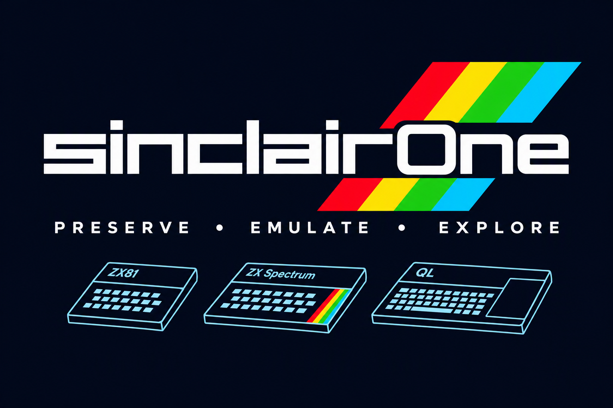

<div align="center">



</div>

# Project Sinclair

Project Sinclair is a Rust workspace for a multi-machine Sinclair emulator.
The Spectrum 16K runs a supplied ROM with approximate timing; the other
machines remain hardware components and architecture previews.

## Workspace

```text
.
├── Cargo.toml
├── docs/
│   └── architecture.md
└── crates/
    ├── sinclair-core/          # machine manager and shared-service contracts
    ├── sinclair-cpu-z80/       # Z80 and its bus contract
    ├── sinclair-spectrum48/   # 16K and 48K Spectrum components
    ├── sinclair-spectrum128/  # 128K memory paging and machine boundary
    ├── sinclair-zx81/         # ZX81 memory, program and video components
    └── sinclair-app/          # Macroquad application
```

See [the architecture document](docs/architecture.md) for the full module
hierarchy, API contracts, expansion strategy, and acceptance criteria. The
[Z80 core guide](docs/z80.md) describes its API, opcode groups and limitations.
[TAP support](docs/tap.md) documents the format and current loading limits.
[TZX support](docs/tzx.md) documents pulse playback and supported blocks.
[SNA support](docs/sna.md) describes 48K snapshot loading and saving.
[Save states and rewind](docs/state.md) describes the in-memory state APIs.
[ZX81 components](docs/zx81.md) describes their current capabilities and limits.
[QL architecture proposal](docs/ql.md) outlines future QL support.
[Machine manager](docs/machine-manager.md) describes registration and lifecycle.
The [128K paging guide](docs/architecture.md#spectrum-128k-memory-and-bus)
describes the 128K memory map and display banks.

## Build and run

Install the stable Rust toolchain and the platform dependencies required by
[Macroquad](https://github.com/not-fl3/macroquad). Then run:

```sh
cargo test --workspace
cargo run -p sinclair-app
```

The application opens a machine menu (Up/Down and Enter); Esc unloads the current machine and returns
to the menu. The Spectrum 16K executes the supplied 48K ROM and displays its
screen. ZX81, Spectrum 48K and 128K can be constructed from supplied ROMs,
but cannot run frames. QL is listed as not implemented.

Create `machine_config.json` in the working directory to configure legally
obtained ROMs. Paths may be absolute or relative to that directory:

```json
{
  "startup_machine": null,
  "zx81_rom": "roms\\zx81.rom",
  "zx81_ram_kib": 16,
  "spectrum48_rom": "roms\\spectrum48.rom",
  "spectrum128_rom0": "roms\\spectrum128-0.rom",
  "spectrum128_rom1": "roms\\spectrum128-1.rom",
  "rewind_history_length": 300
}
```

Set unused ROM paths to `null` or omit them. The 16K machine also uses
`spectrum48_rom`. ROM 0 is 128K BASIC and ROM 1 is
48K BASIC. The last successfully selected machine becomes the startup machine;
set it to `null` to start at the menu. Invalid configuration is reported and
not overwritten. The manager supports programmatic media, quick-state and
rewind operations; these are not yet exposed as app controls.

The 16K model runs the Z80, keyboard and snapshot renderer together, but does
not yet model contention, raster-accurate video or tape loading. It produces
beeper samples, but the application does not play audio. For the other
Spectrum models, the Z80, memory/bus and ULA renderer are not yet connected.
The preview includes a Spectrum keyboard matrix display: Shift is CAPS SHIFT
and Ctrl is SYMBOL SHIFT. On the 48K, TAP images can be mounted and
validated, and TZX pulse playback is available, but neither is connected to
ROM-driven loading. In-memory save states and rewind are available through
the machine APIs, but the application has no snapshot controls. Audio output
and other machines' audio hardware are not implemented. No ROM is distributed; emulation must
use a legally obtained compatible ROM.

The ZX81 crate provides a machine boundary with input and in-memory state,
1K/16K memory mapping, direct `.p` image copying, PCM WAV tape input and a
non-cycle-timed display-file renderer. It requires an externally supplied 8K
ZX81 ROM. It provides instruction-level stepping but not a frame loop,
cycle-timed video or complete FAST/SLOW display timing.
