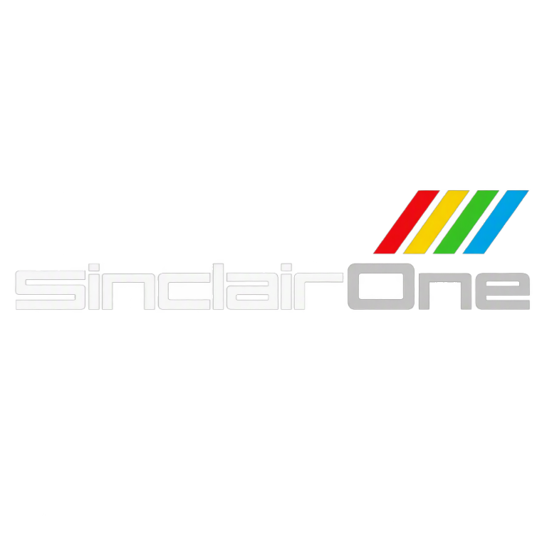

<div align="center">



</div>

# Project Sinclair

Project Sinclair is a Rust workspace for a multi-machine Sinclair emulator.
Its first target is the ZX Spectrum 48K; this repository currently contains
architecture and executable skeletons, **not a working emulator**.

## Workspace

```text
.
├── Cargo.toml
├── docs/
│   └── architecture.md
└── crates/
    ├── sinclair-core/          # machine and shared-service contracts
    ├── sinclair-cpu-z80/       # Z80 and its bus contract
    ├── sinclair-spectrum48/   # 48K machine, memory map and media boundary
    └── sinclair-app/          # Macroquad application
```

See [the architecture document](docs/architecture.md) for the full module
hierarchy, API contracts, expansion strategy, and acceptance criteria. The
[Z80 core guide](docs/z80.md) describes its API, opcode groups and limitations.
[TAP support](docs/tap.md) documents the format and current loading limits.

## Build and run

Install the stable Rust toolchain and the platform dependencies required by
[Macroquad](https://github.com/not-fl3/macroquad). Then run:

```sh
cargo test --workspace
cargo run -p sinclair-app
```

The application is an architecture preview, not a running machine. The Z80,
Spectrum memory/bus and ULA snapshot renderer are not yet connected. The
preview includes a keyboard matrix display: Shift is CAPS SHIFT, Ctrl is
SYMBOL SHIFT, and Esc releases held keys. TAP images can be mounted and
validated, but ROM-driven loading is not implemented. Audio and state handling
are not implemented. No ROM is distributed; future emulation must use a legally
obtained compatible ROM.
